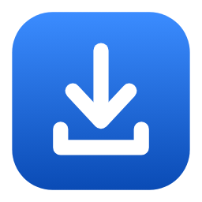
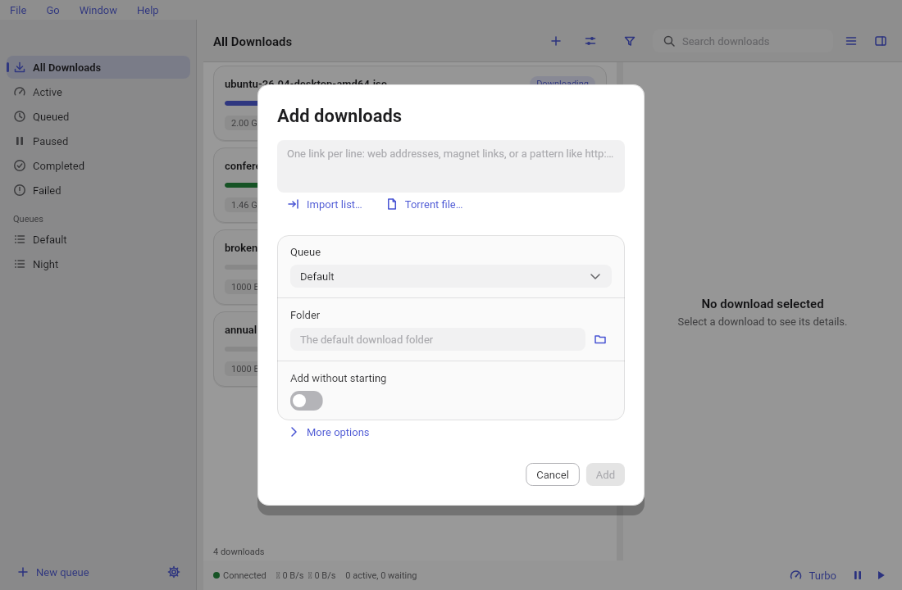
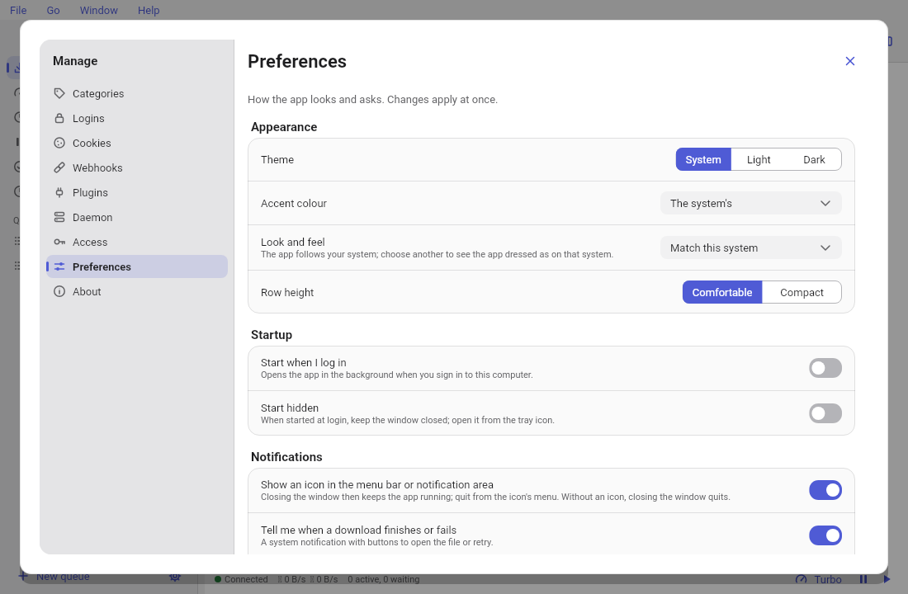
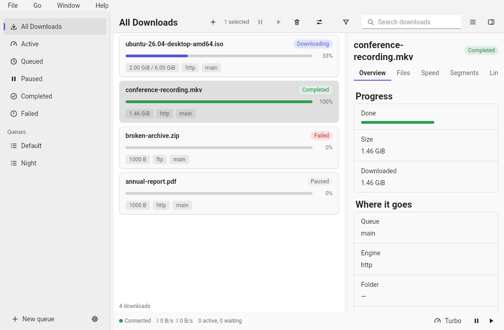
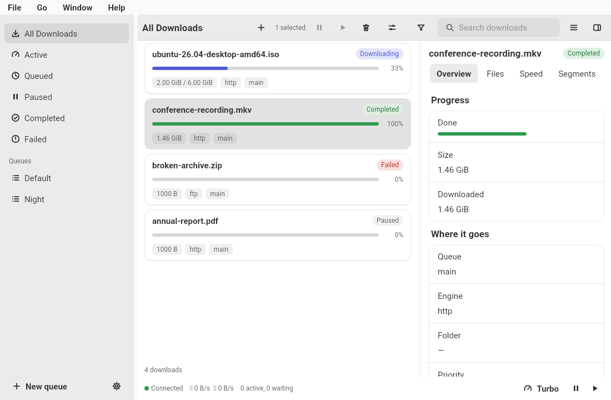
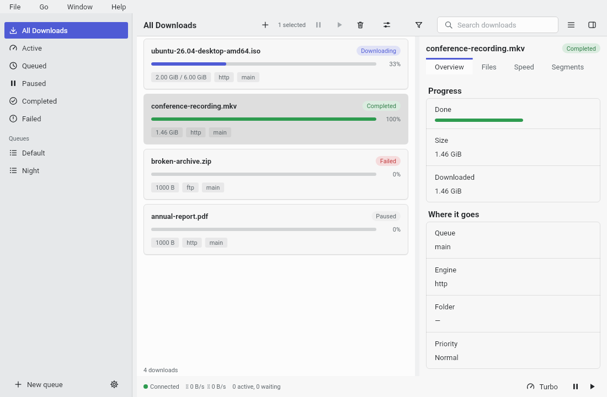

<div align="center">



# DLM

**A download manager that feels at home on your desktop.**<br />
Fast, tidy and quiet. Paste a link, go and make a coffee, come back to your file.

[](https://github.com/sabadia/dlm-app/releases/latest)
[](#install)
[](LICENSE)

<picture>
  <source media="(prefers-color-scheme: dark)" srcset="docs/images/macos/downloads_dark.png">
  
</picture>

</div>

---

## Why you might like it

- 🧭 **It looks like it belongs.** On a Mac it looks like a Mac app, on Windows like a Windows app, on GNOME and
  KDE like theirs. It follows your light or dark mode and your accent colour.
- 🚀 **It is fast, even with a mountain of downloads.** Tens of thousands of items scroll smoothly, and it
  starts in about a quarter of a second.
- 🔗 **It deals with the awkward stuff.** Expiring links, sites that need a login, pages that hide the file,
  video pages, torrents: DLM handles them so you do not have to.
- 🔒 **It is private.** Everything runs on your computer. Passwords and cookies live in your system's secure
  storage and never end up in a log.
- 🆓 **It is free and open source** under the Apache-2.0 licence.

---

## Install

Pick your system. It takes about a minute.

| | |
|---|---|
| 🍎 **macOS** | `brew install --cask sabadia/tap/dlm-app`<br />or download the **`.dmg`** from the [latest release](https://github.com/sabadia/dlm-app/releases/latest) and drag DLM to Applications. |
| 🪟 **Windows** | Download the **`…_setup.exe`** from the [latest release](https://github.com/sabadia/dlm-app/releases/latest). It installs just for you; no administrator needed. Prefer no installer? Use the portable **`.zip`**. |
| 🐧 **Linux** | Download the **`.deb`**, **`.rpm`** or **`.tar.gz`** from the [latest release](https://github.com/sabadia/dlm-app/releases/latest). |

Every file comes with a checksum (and `SHA256SUMS` lists them all) so you can check your download.

> **Good to know: the app is not signed yet.** That is why your computer is a little suspicious of it
> the first time.
>
> - **macOS** says it cannot check the app: right-click DLM in Applications, choose **Open**, then **Open**
>   again. Or run `xattr -dr com.apple.quarantine /Applications/DLM.app` once.
> - **Windows** shows "Windows protected your PC": click **More info**, then **Run anyway**.
>
> You only do this once. Signed builds are planned.

**Updating with Homebrew:** `brew upgrade dlm-app`. (There is no `dlm@latest`, and plain `dlm` is the
command-line tool. Homebrew 7 may ask you to run `brew trust --tap sabadia/tap` once.)

---

## Your first download in 30 seconds

1. **Open DLM.** The first time, it asks where to save files and shows which helper tools it found.
2. **Press <kbd>Ctrl</kbd>+<kbd>N</kbd>** (<kbd>⌘</kbd>+<kbd>N</kbd> on a Mac), or drop a link or a `.torrent`
   file onto the window.
3. **Paste your links**, one per line, and press **Add**.

<div align="center">
<picture>
  <source media="(prefers-color-scheme: dark)" srcset="docs/images/macos/add_dialog_dark.png">
  
</picture>
</div>

That is it. DLM shows progress, speed and time left, and tells you when it is done. Close the window and it
keeps going quietly from the menu bar or tray.

---

## What it can do

### Download almost anything

- **Web files** split into several connections at once, so big files arrive faster, and **resume** where
  they stopped if your connection drops.
- **Torrents and magnet links**, plus FTP, video streams (HLS and DASH) and ed2k.
- **Video and audio pages** through yt-dlp, when you have it installed.
- **Patterns**: type `http://site/photo[001-100].jpg` and get all one hundred.
- **Lists**: import a list of links from a file, or export your downloads.
- **Mirrors and checksums**: give DLM other places that have the same file, and a checksum to verify it.

### Stay in control

- **Queues** that run at the times you choose, with a weekly schedule, speed limits, quotas and a plan for
  when they finish (do nothing, stop, sleep, shut down).
- **Turbo**: lift the speed limit for an hour with one click.
- **Categories** that sort finished files into the right folders by type.
- **Pause, resume and retry** one download or a hundred.
- **A live details pane** for each download: files, a speed graph, a map of its segments, and its links.

<div align="center">
<picture>
  <source media="(prefers-color-scheme: dark)" srcset="docs/images/macos/settings_dark.png">
  
</picture>
</div>

### Links that fix themselves

Download links often expire halfway. DLM remembers the page each link came from and **gets a fresh link for
you**, even from pages that need a real browser, a login or cookies. Your download carries on as if nothing
happened.

### Your browser's downloads, in DLM

The [DLM browser extension](docs/user/browser-extension.md) (Chrome, Edge, Brave, Opera, Vivaldi and
Firefox) sends your browser's downloads to DLM. You allow each extension once, in the app, and can
revoke it any time. When a link has expired, DLM tells you and opens the page for a new one.

### Always within reach

- 🔔 **Notifications** when a download finishes, fails or a queue ends, with buttons to open the file, show
  it in its folder, or try again.
- 🧲 **Open links from anywhere:** magnet links, torrent files and `dlm:` links open straight in DLM.
- 📋 **Clipboard helper** (off until you turn it on) offers to add a link you just copied.
- ⌨️ **Global shortcuts** (you choose them) to show DLM or add the link on your clipboard from any program.
- 🌙 **Keeps your Mac or PC awake** while it downloads, and shows progress on the dock or taskbar.
- 🔎 **Search, filter, sort and group** your list, and a **command palette** (<kbd>Ctrl</kbd>/<kbd>⌘</kbd>+<kbd>K</kbd>)
  that finds any action by name.

### Made for everyone

- Works with the keyboard from top to bottom, labelled for screen readers, with high contrast and large text
  supported.
- Follows your system's light or dark mode, accent colour, text size and reduced-motion setting.
- Ready for translation, with a language picker (English today).

---

## It looks native, on every desktop

One app, four looks. Each one follows its desktop's own style.

<div align="center">

| macOS | Windows |
|:---:|:---:|
|  |  |
| **GNOME** | **KDE Plasma** |
|  |  |

<sub>These pictures are drawn by our automated tests with sample data, so they always match the app.
<a href="docs/images/README.md">See them all, in light and dark.</a></sub>

</div>

---

## Questions

**Where are my downloads saved?** In the folder you chose on first start. Change it any time in Settings, or
let categories sort files into different folders.

**Does it send my data anywhere?** No. DLM and its download service run on your computer. It only talks to
the sites you download from, and to GitHub if you ask it to check for updates.

**Does it need anything else installed?** No. DLM brings its own download service. For video pages it can use
`yt-dlp` and `ffmpeg` if you have them, and the first-start screen tells you what it found.

**Can I use a download service on another computer?** Yes. Point DLM at a remote `dlm` service and trust its
certificate the first time.

**Something went wrong.** See the [troubleshooting guide](docs/user/troubleshooting.md), or
[open an issue](https://github.com/sabadia/dlm-app/issues/new/choose) and paste the diagnostics from the
**About** page (they contain no secrets).

**Want to try newer builds?** Join the [beta](docs/beta.md).

---

## Learn more

| | |
|---|---|
| 📖 [User guide](docs/user/README.md) | Getting started, every feature, shortcuts, troubleshooting |
| 🧪 [Beta programme](docs/beta.md) | Help us check it on real machines |
| 🛠️ [Contributing](CONTRIBUTING.md) | Set up, add a component, a skin or a language |
| 🗺️ [Plan](docs/PLAN.md) | What is built and what is next |
| 🧩 [dlm](https://github.com/sabadia/dlm-server) | The download service and command-line tool behind DLM |

---

## For developers

DLM is a [Flutter](https://flutter.dev) desktop app on top of the [`dlm`](https://github.com/sabadia/dlm-server)
daemon, which does the downloading and exposes a REST API. The app bundles the daemon and manages it, or
connects to a remote one.

```sh
git clone https://github.com/sabadia/dlm-app && cd dlm-app
fvm install                      # Flutter and Dart are pinned in .fvmrc
dart pub get                     # one pub workspace for every package
cd apps/dlm_app && flutter run -d macos     # or windows, linux
```

`flutter run` starts the daemon it finds: set `DLM_DAEMON` to a binary, or put `dlm` on your `PATH`
(`bash tools/fetch_daemon.sh <version> <dir>` downloads a checksum-verified release). Run the checks CI runs:

```sh
dart format .
dart analyze --fatal-infos
dart run dlm_tools:check_imports
dart run dlm_tools:test_all --exclude-tags golden
```

```
apps/dlm_app/      the Flutter app and its platform runners
apps/dlm_gallery/  every UI component in every skin, for development
packages/          dlm_api, dlm_core, dlm_ui_kit, dlm_skin_*, dlm_platform, dlm_l10n
tools/             checks and release scripts
packaging/         per-OS installers, Homebrew cask
docs/              plan, guides, architecture decisions
```

The look of each desktop is a *skin* on a shared UI kit, so features never care which OS they run on.
Read [the UI kit notes](docs/ui-kit.md) and [the app shell](docs/app-shell.md) to see how it fits together,
and [the engineering conventions](docs/CONVENTIONS.md) before sending a change.

---

<div align="center">

Made with ☕ and Flutter · [Apache-2.0](LICENSE) · See [NOTICE](NOTICE)

</div>
