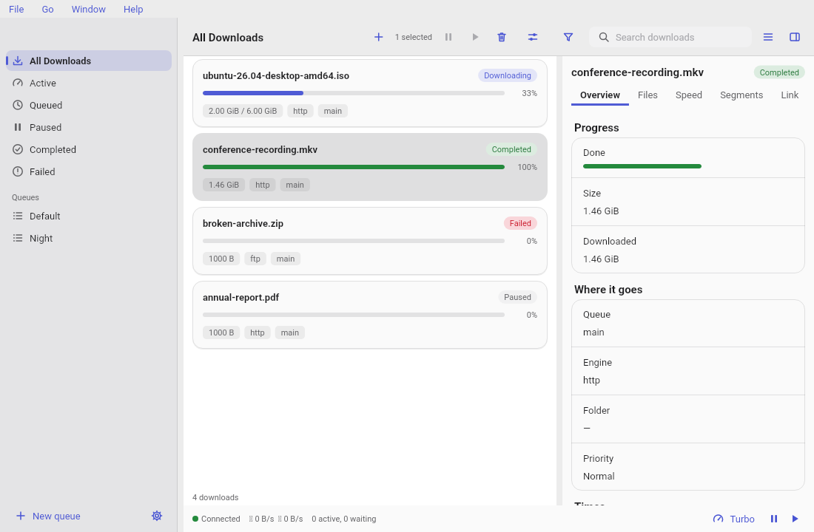

# Downloads

## The list

Each download is a card: its name and state, a progress bar, and chips for size, speed, time left, engine,
queue and category. Use the **Display** menu to sort (name, size, added, progress, state) and to group.
The search field filters by text. The list loads 100 at a time and follows changes live, so it stays quick
with a very large number of downloads.

Select one or many with the mouse or the keyboard. **Pause**, **Resume** and **Delete** act on the
selection from the toolbar, the right-click menu, or the keyboard (Delete or Backspace). Pause and resume
offer **Undo**. Delete always asks first; the files stay on disk unless you tick the box, and a removed
download cannot be brought back.

## The status bar

The bar at the bottom shows the connection, the current speed down and up, how many downloads are active
and waiting, and the quota used when a queue has one. **Turbo** lifts the speed limit for 60 minutes
(press it again to end it early), and the buttons at the right pause or resume everything.

## The details pane

Select one download and open the pane (toolbar, or the Window menu). It has five tabs, and remembers the
one you used last:

- **Overview**: progress, speed, time left, connections, queue, engine, folder, priority, times and the last
  error.
- **Files**: a folder tree of the files; files that were not chosen are marked.
- **Segments**: a map of the pieces the file is split into, which are downloaded and which are still to do (or a note that the download is not split).
- **Speed**: a live graph of the last 120 updates, kept only while the pane is open.
- **Link**: the current, first, page and referrer links; **Renew now**, **Wait for a new link**, **Replace
  link**, and the renewal history. Replacing the link needs the download paused; DLM starts again if the
  file does not match.

The pane closes by itself when the window is narrower than 1000 px. Drag the edges to resize panels.

## Queues

A queue holds downloads and runs them in order. **New queue** is under the queues in the sidebar. A queue's
page has Start and Stop, a menu to rename, move or delete it, and **Settings**:

- a speed limit and a weekly **schedule** (one cell per hour);
- **speed profiles** (a different limit while chosen hours are active) and a **quota** (bytes per period);
- what happens when the queue finishes: nothing, stop, sleep, shut down, or run a program, after a grace
  period. A banner counts the seconds down and **Stop** cancels it.

Deleting a queue moves its downloads to the default queue, which cannot be deleted. Speed profiles, quotas
and finish actions need `dlm` 0.3.0 or newer.

## Categories

A category sorts finished downloads into a folder by its file extension or content type; the first category that matches wins, so the order matters. Manage them under
**Manage, Categories**. The add dialog tells you which category a download will land in.

## Notifications and the tray

When a download finishes or fails, a link expires, or a queue finishes, DLM shows a system notification
(you can turn each off in Preferences). The buttons open the file, reveal it, or download it again. While
downloads run, DLM keeps your computer from sleeping (the screen may still sleep) and shows a count and
progress on the dock or taskbar.
